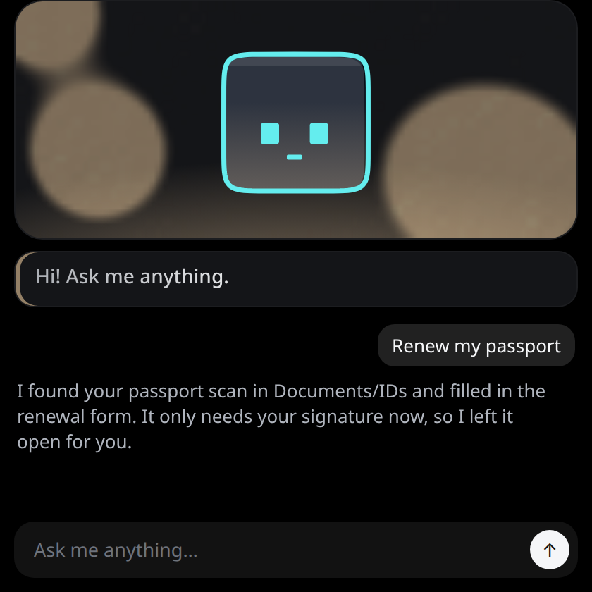
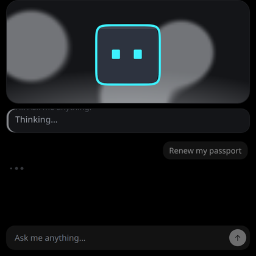
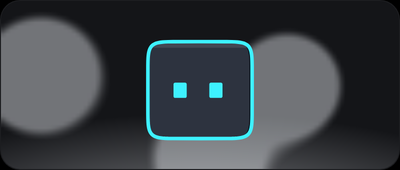
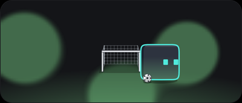
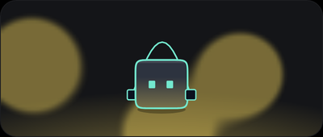
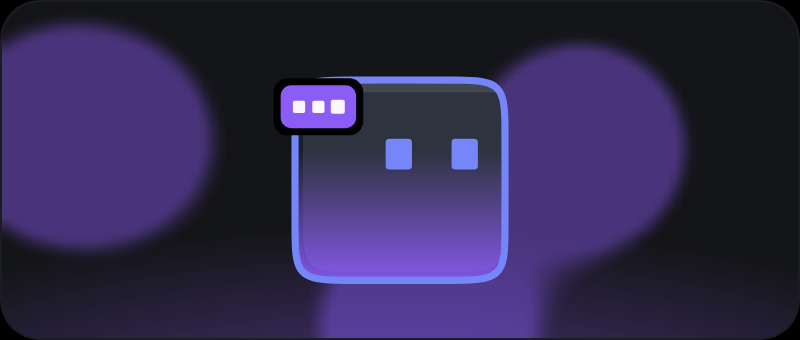
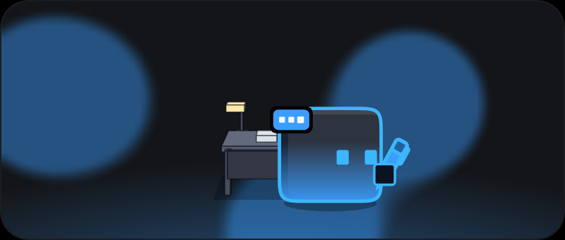
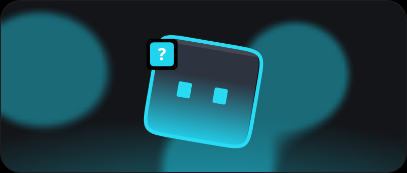

# Uriel companion

A small desktop window for chatting with [Uriel](https://github.com/TonyHeadband/uriel-agent), a family assistant that
runs on a home server. A neon character at the top shows what Uriel is doing (thinking, searching, working, done,
stuck) with its face, colour and motion, and talks back in synthesized blips. Tauri 2 + TypeScript, for Linux, macOS
and Windows.

<p>
  
  
</p>

When it's idle, it drifts, blinks and glances about. Left alone long enough, it finds something to do.

| Idle | Football | Jump rope |
| --- | --- | --- |
|  |  |  |

| Idle | Thinking | Working | Question |
| --- | --- | --- | --- |
|  |  |  |  |

Every state, scene and angle is in the [gallery](docs/gallery.md). All of it is rendered from `preview.html` at a
fixed seed: `npm run screenshots` renders the stills and `npm run clips` records the clips (it needs ffmpeg).

## Inspired by coucou

The idea comes from [coucou](https://github.com/Louis-CFM/coucou) by Louis Raillé: a small animated companion that
sits at the edge of the screen and reacts to what Claude Code is doing. This project applies the same idea to a
self-hosted assistant instead. It shares no code layout, character, name, icon or sound with coucou; only some
animation numbers were ported (see [Acknowledgements](#acknowledgements)).

### How this differs

| | coucou | Uriel companion |
| --- | --- | --- |
| Talks to | Claude Code, through hooks over a socket or pipe | The Uriel gateway over HTTP and SSE, signed in with OIDC (Authorization Code + PKCE) |
| Window | Notch or screen-edge bar | A normal chat window with a history log |
| Character | Mochi, a soft squircle | Grid, a square neon character drawn procedurally, with squash, stretch and a soft-body outline |
| Behaviour | Reacts to session events | A state engine: the turn, touch, sleep and expressions claim layers with priorities, so a poke can interrupt a reply and sleep never overwrites work |
| Sound and voice | Sound effects | Everything synthesized in the Web Audio API; replies are spoken as blips with a phonetic mouth |
| Platforms | macOS (Swift) and Windows (Tauri) | One Tauri 2 codebase for Linux, macOS and Windows |
| Assets | Handcrafted sound effects | None: no images, audio or fonts to license; the character and sounds are code |

## Requirements

Node 20+, Rust (stable), and on Fedora:

```bash
sudo dnf install webkit2gtk4.1-devel openssl-devel dbus-devel librsvg2-devel libappindicator-gtk3-devel libxdo-devel gtk3-devel
```

## Commands

```bash
npm install
npm test               # unit tests (Vitest)
npm run preview:dev    # the character and debug panel in a browser, no Tauri or gateway needed
npm run tauri dev      # the app
cargo test --manifest-path src-tauri/Cargo.toml
```

## Docs

- [Gallery](docs/gallery.md): every state, scene and clip.
- [Design](docs/specs/2026-09-30-companion-app-design.md), plus the specs for the [liquid body](docs/specs/2026-10-01-liquid-body-design.md) and the [talking mouth](docs/specs/2026-10-01-talking-mouth-design.md).
- Before a release, run the [manual checks](docs/manual-checks.md) on each OS.

## Dev without Authelia

1. Set `"auth": {"mode": "api_key"}` in the config file (Linux:
   `~/.config/com.homelab-station.uriel-companion/config.json`).
2. Store a gateway service key once, from the app's devtools console:
   `window.__TAURI_INTERNALS__.invoke("set_api_key", { key: "<key>" })`.

A service key acts as one fixed principal, so it's never for family machines.

## Acknowledgements

The easing curves and gesture timings in `src/engine/anim.ts` and `src/engine/gestures.ts` are adapted from [coucou](https://github.com/Louis-CFM/coucou), used under its MIT license:

> Copyright (c) 2026 Louis Raillé
>
> Permission is hereby granted, free of charge, to any person obtaining a copy of this software and associated
> documentation files (the "Software"), to deal in the Software without restriction, including without limitation the
> rights to use, copy, modify, merge, publish, distribute, sublicense, and/or sell copies of the Software, and to
> permit persons to whom the Software is furnished to do so, subject to the following conditions: The above
> copyright notice and this permission notice shall be included in all copies or substantial portions of the Software.
> THE SOFTWARE IS PROVIDED "AS IS", WITHOUT WARRANTY OF ANY KIND, EXPRESS OR IMPLIED, INCLUDING BUT NOT LIMITED TO THE
> WARRANTIES OF MERCHANTABILITY, FITNESS FOR A PARTICULAR PURPOSE AND NONINFRINGEMENT.

coucou's name, the Mochi character (its design, look, expressions and animations), its icons and its sounds are
reserved by the author under [LICENSE-ASSETS.md](https://github.com/Louis-CFM/coucou/blob/main/LICENSE-ASSETS.md).
None of them are used here.

## License

[MIT](LICENSE)
