# Gallery

Every image here is rendered from `preview.html`, the same engine and renderers the app runs, at a fixed seed:

- `npm run screenshots` renders the stills.
- `npm run clips` records the animated WebP clips and the window shot on a fake clock, frame by frame.

The character comes out the same on every run.

## The window

The character sits in a strip at the top. Under it, a ticker line says what it's doing, and the conversation follows.

## A turn

"Renew my passport", played from a script through the real chat controller. It thinks, then searches the shelves
for the scan, fills in the form at the desk, does a happy roll when the reply starts, and talks it through before
settling back to idle.

## Idle

With nothing to do, it drifts around its square, blinks, and glances about or at the cursor.

## Pastimes and scenes

Left idle long enough, it finds something to do. Each scene's props rise into the strip and the camera pulls back.
Going to sleep works the same way: the bedroom rises and it jumps into bed.

| Football | Jump rope |
| --- | --- |
|  |  |
| **Coffee** | **Sleeping** |
|  | 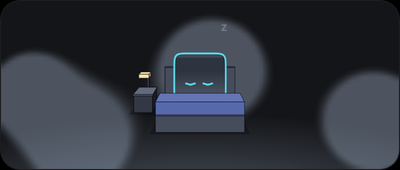 |

Work has scenes too: it searches at a bookshelf and works at a desk. There's also reading and watering a plant.

| Shelf (searching) | Desk (working) | Reading | Watering |
| --- | --- | --- | --- |
| 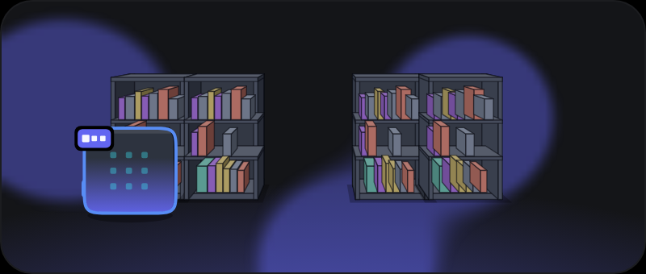 | 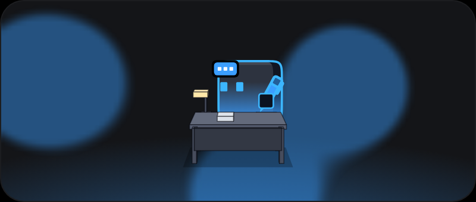 | 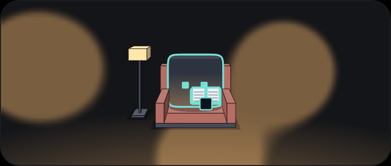 | 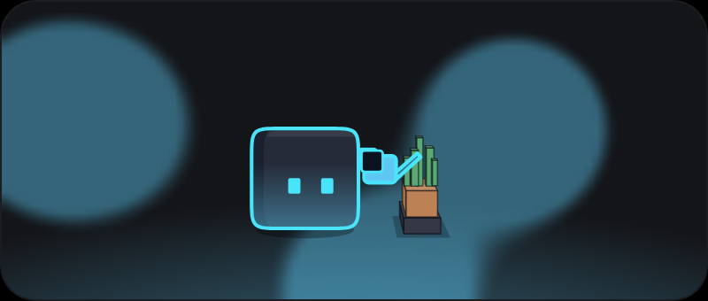 |

## States

Each state has its own colour, face, badge and motion.

| Idle | Thinking | Searching | Working | Finished |
| --- | --- | --- | --- | --- |
|  |  | 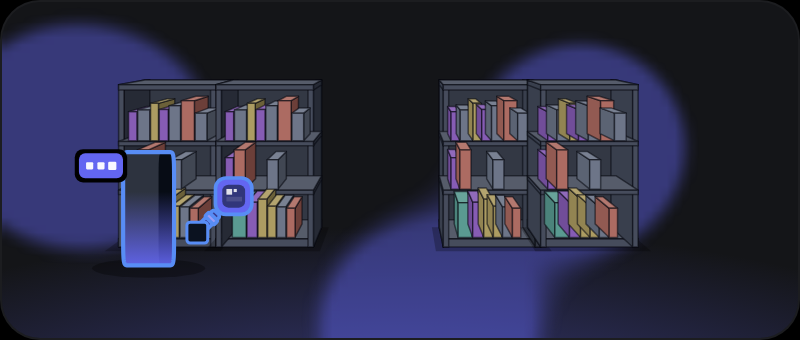 |  | 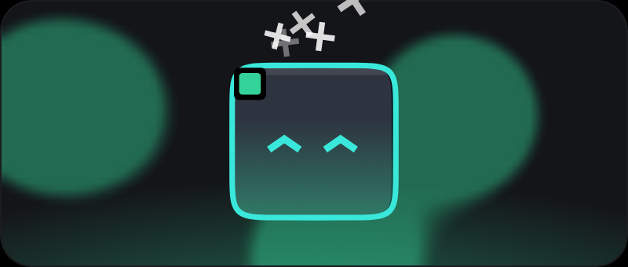 |
| **Question** | **Approval** | **Error** | **Sleeping** | **Dizzy** |
|  |  | 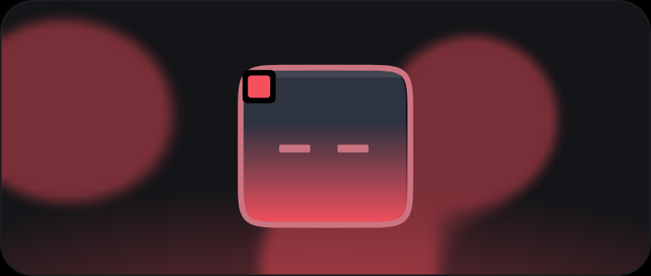 | 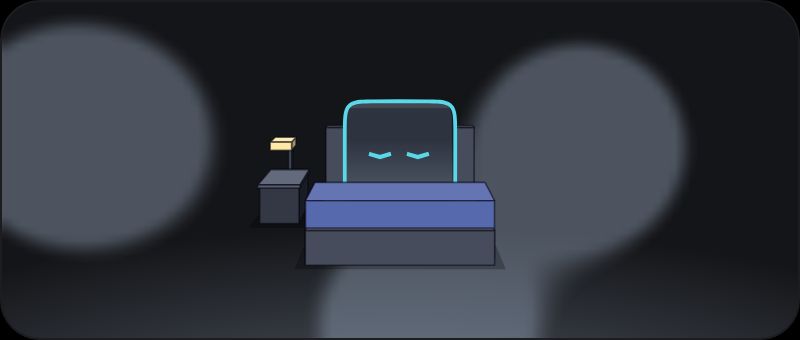 |  |

- **Question:** the reply ended on a question for you.
- **Approval:** a draft is waiting for your yes.
- **Error:** it couldn't reach home, or the turn failed.
- **Dizzy:** you poked it three times fast.

## Turning

The 2.5D renderer draws the body as a box with depth, so it can turn and walk to the props in a scene.

| Front | Quarter | Side | Back |
| --- | --- | --- | --- |
|  |  |  |  |

## 2D and 2.5D

There are two renderers, and you switch between them in the settings. 2D is the flat neon outline. 2.5D, the default,
adds depth and shading.

| | Idle | Working | Error | Desk |
| --- | --- | --- | --- | --- |
| **2D** |  | 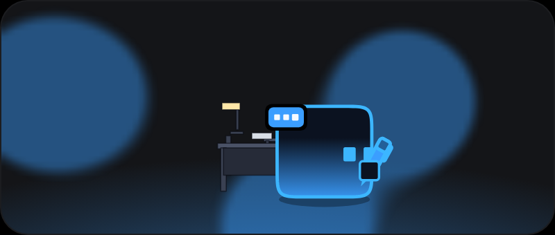 | 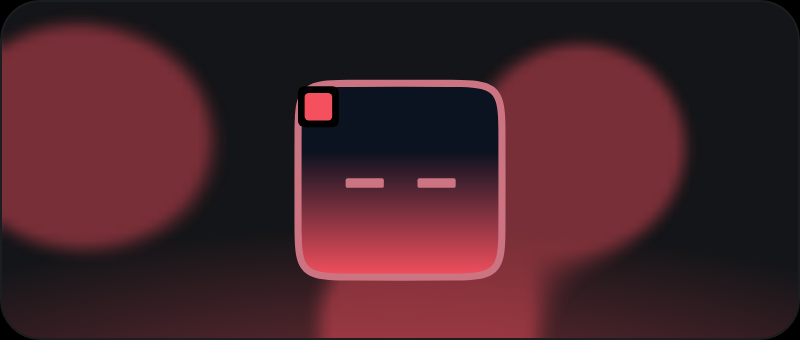 | 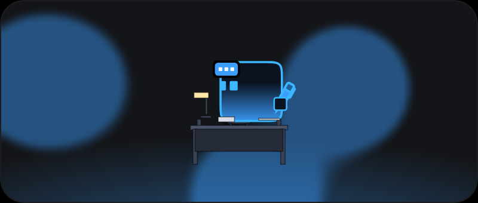 |
| **2.5D** |  |  |  |  |
